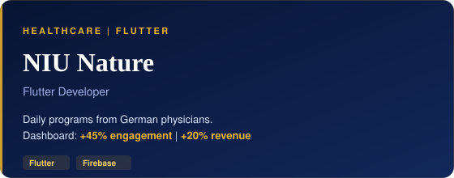
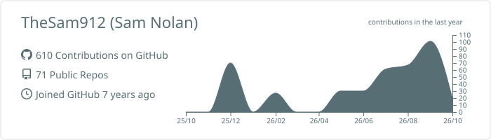
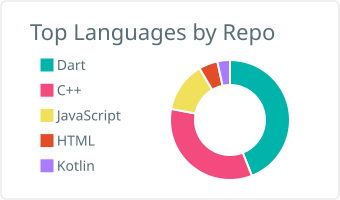
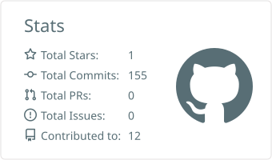

  

  
  
  
  

  

 

  

### About

I'm **Sobhan Daroogheh** — preferred name **Sam**.

I turn product requirements into fast, polished **web and mobile apps** — and make sure people can actually find them through **SEO & GEO**.

Currently rebuilding **Fanavaran** for Android & iOS in React Native, alongside its CLI, website and backend. Master's in Cybersecurity, University of Padua. Open to projects worldwide.

 

### Stack

   
  

 

### Selected work

<table>
  <tr>
    <td width="50%" valign="top">
      
      
<a href="https://play.google.com/store/apps/details?id=com.fanavaran.app&hl=en">Google Play</a> · <a href="https://fanavaran.ca/">fanavaran.ca</a>

    </td>
    <td width="50%" valign="top">
      
      
<a href="https://www.destinology.co.uk/">destinology.co.uk</a>

    </td>
  </tr>
  <tr>
    <td width="50%" valign="top">
      
      
<a href="https://wealthio.ir/">wealthio.ir</a>

    </td>
    <td width="50%" valign="top">
      
      
<a href="https://www.niu-nature.app/">niu-nature.app</a>

    </td>
  </tr>
</table>

 

### GitHub

  <picture>
    <source media="(prefers-color-scheme: dark)" srcset="./profile-summary-card-output/github_dark/0-profile-details.svg" />
    
  </picture>

  <picture>
    <source media="(prefers-color-scheme: dark)" srcset="./profile-summary-card-output/github_dark/1-repos-per-language.svg" />
    
  </picture>
  <picture>
    <source media="(prefers-color-scheme: dark)" srcset="./profile-summary-card-output/github_dark/3-stats.svg" />
    
  </picture>

  

  <picture>
    <source media="(prefers-color-scheme: dark)" srcset="https://raw.githubusercontent.com/TheSam912/TheSam912/output/github-snake-dark.svg" />
    
  </picture>

---

  Let's build something people love to use — <a href="mailto:The.Sam.Nolan1998@gmail.com">The.Sam.Nolan1998@gmail.com</a>

